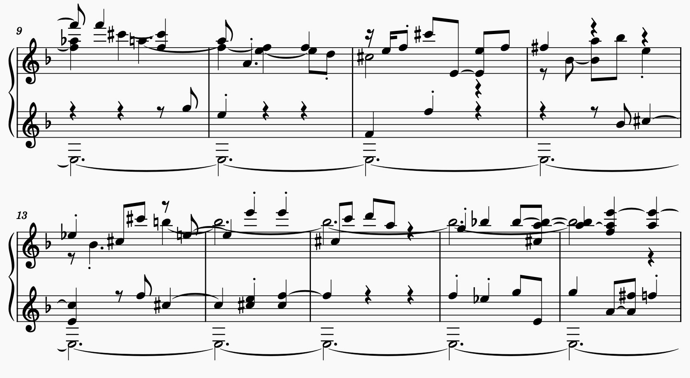

# Performance RNN in PyTorch



[](https://github.com/anatrini/performance_rnn_torch/actions/workflows/tests.yml)
[](LICENSE)

A recurrent neural network that plays the piano: it learns from MIDI recordings of pianists and generates new performances note by note, with their timing and dynamics. It follows Magenta's [Performance RNN](https://magenta.tensorflow.org/performance-rnn) (Simon & Oore, 2017): the same event vocabulary, controls and model settings, in PyTorch.

The generation can be steered with two controls: how many notes per second, and which pitch classes are used.

Developed for the course [Artificial Models for Multimodal Creativity](https://github.com/anatrini/AMMC-HfMT) at the Hochschule für Musik und Theater Hamburg.

## Contents

1. [Installation](#installation)
2. [Quick start](#quick-start)
3. [Commands](#commands)
4. [How a performance is represented](#how-a-performance-is-represented)
5. [The model and its settings](#the-model-and-its-settings)
6. [Generating](#generating)
7. [Playing in real time from Max or Pd](#playing-in-real-time-from-max-or-pd)
8. [Using it from Python](#using-it-from-python)
9. [Development](#development)
10. [Credits and license](#credits-and-license)

## Installation

You need [uv](https://docs.astral.sh/uv/getting-started/installation/). uv installs the right Python (3.12 or later) and all dependencies in a folder `.venv` inside the project; nothing else on the computer changes.

```bash
git clone https://github.com/anatrini/performance_rnn_torch.git
cd performance_rnn_torch
uv sync --all-extras
```

`--all-extras` adds TensorBoard (training curves) and Optuna (hyperparameter search); `uv sync` alone installs only what is needed to train and generate.

Check the installation:

```bash
uv run prnn --help
```

**Hardware.** Training uses an NVIDIA GPU (CUDA) or Apple Silicon (MPS) when available, otherwise the CPU; generation runs well on any of them.

- macOS and Linux: nothing else to do. On Linux, the PyTorch packages from PyPI already include CUDA.
- Windows with an NVIDIA GPU: the default PyTorch package for Windows has no CUDA. After `uv sync`, replace it with the one that matches your driver, and run the commands with `--no-sync` so that uv does not put the other one back:

  ```bash
  uv pip install --reinstall torch --torch-backend=auto
  uv run --no-sync prnn train
  ```

## Quick start

From MIDI files to new performances, in the project folder:

```bash
# 1. MIDI files: MAESTRO (see below) or your own, in data/midi/<name>/
uv run prnn prepare --composer "Johann Sebastian Bach"

# 2. Convert them to training data (data/processed/)
uv run prnn preprocess

# 3. Train (models/train.sess)
uv run prnn train

# 4. Generate 8 performances (output/train_001.mid ...)
uv run prnn generate
```

**MAESTRO.** [MAESTRO v3.0.0](https://magenta.tensorflow.org/datasets/maestro) contains about 200 hours of performances recorded at the International Piano-e-Competition. Download the MIDI files ([maestro-v3.0.0-midi.zip](https://storage.googleapis.com/magentadata/datasets/maestro/v3.0.0/maestro-v3.0.0-midi.zip), 58 MB) and unzip them into `data/`, so that `data/maestro-v3.0.0/maestro-v3.0.0.csv` exists. `uv run prnn prepare --list` shows the composers.

**Your own MIDI files.** Put them in `data/midi/`, one folder per collection, e.g. `data/midi/my_pieces/`. Any instrument except drums is read; piano music works best.

**Working folders.** `prnn` creates `data/`, `models/`, `output/`, `logs/` and `runs/` in the current folder, or in the folder given by the environment variable `PERFORMANCE_RNN_HOME`.

## Commands

| Command | What it does | Main options |
|---|---|---|
| `prnn prepare` | copies the MIDI files of one composer from MAESTRO to `data/midi/<composer>/` | `--list`, `--composer`, `--maestro-dir`, `--output` |
| `prnn preprocess` | MIDI files to training data (`.npz`), keeping the folder structure | `-m` MIDI folder, `-s` output folder, `-w` worker processes |
| `prnn train` | trains a model, or continues one | `-S` checkpoint, `-d` data, `-M` model settings, `-e` epochs, `-b` batch size, `-T` transposition |
| `prnn generate` | writes MIDI files with a trained model | `-s` checkpoint, `-l` length, `-T` temperature, `-c` controls, `-k`/`-p` top-k/top-p, `-B` beam search |
| `prnn optimize` | searches hyperparameters with Optuna | `-n` trials |
| `prnn serve` | plays a model in real time, controlled over OSC from Max or Pd | `-s` checkpoint, `--port`, `--send-port`, `--lookahead` |

`uv run prnn <command> --help` lists every option with its default and examples. Every command that uses the model also accepts `--device` (`auto`, `cpu`, `mps`, `cuda`) and `--seed`.

## How a performance is represented

A performance is a sequence of events, from a vocabulary of 388, as in Magenta:

| Event | Number | Meaning |
|---|---|---|
| note-on | 128 | a key is pressed (MIDI pitch 0–127) |
| note-off | 128 | a key is released |
| time shift | 100 | time moves forward by 10 ms to 1 s |
| velocity | 32 | loudness of the following notes, in 32 steps |

Times are rounded to 10 ms. When a MIDI file is read, the sustain pedal (controller 64) is applied to the notes: a note held by the pedal lasts until the pedal is released or the same key is played again.

Each event also has a **control vector** that describes the music that follows it:

- **note density**: notes per second in the next 3 seconds, in 8 classes:

  | class | 0 | 1 | 2 | 3 | 4 | 5 | 6 | 7 |
  |---|---|---|---|---|---|---|---|---|
  | notes per second | < 1 | 1–2 | 2–4 | 4–8 | 8–16 | 16–32 | 32–64 | ≥ 64 |

- **pitch class histogram**: how long each of the 12 pitch classes (C to B) sounds in the next 5 seconds.

The model learns to continue a performance in a way that matches the controls; at generation time you choose them.

## The model and its settings

A stack of GRU layers reads the previous event and the controls, and gives the probability of every possible next event. During training the true previous events are the input; the loss is the cross entropy of the predicted events.

The defaults are Magenta's: **3 layers of 512 units, no dropout, batches of 64**, gradient norm clipped at 3, learning rate 0.001. They suit a large dataset such as MAESTRO and a GPU.

**If training is too slow** on your computer, use a smaller model and smaller batches:

```bash
uv run prnn train -M "hidden_dim=256,gru_layers=2" -b 32
```

**If the model learns the training files by heart** (the validation loss rises while the training loss keeps falling, which happens with few files), add dropout or use a smaller model:

```bash
uv run prnn train -M "gru_dropout=0.3"
```

Other useful options of `prnn train`:

- `-T` transposes every batch by a random interval (−6 to +5 semitones): more variety from the same files.
- `-w` events per training window (default 100), `-e` epochs (default 15), `-p` early stopping after so many epochs without improvement (default 5).
- `-f` teacher forcing ratio: below 1, some steps receive the model's own prediction instead of the true event (scheduled sampling); slower.

The best model (lowest validation loss) is saved to the checkpoint, the most recent state next to it as `<name>-last.sess`. Running the same command again continues the training. Training curves, if TensorBoard is installed:

```bash
uv run tensorboard --logdir runs
```

An example, on the 144 Bach pieces of MAESTRO with transposition (`-T`), on an M1 Pro: with these defaults the best validation loss was 2.43, after 3 epochs (25 minutes); then the model began to learn the training files by heart. With `-M "gru_dropout=0.3"` it kept improving until epoch 9 and reached 2.35, in about 70 minutes. That second model is attached to the [release](https://github.com/anatrini/performance_rnn_torch/releases/latest) as `bach.sess`.

**Hyperparameter search.** `uv run prnn optimize -n 20` trains 20 models with different sizes, dropout, batch sizes, windows and learning rates, and keeps the best one in `models/optimization/` with its settings in `best-params.json`. It takes hours.

## Generating

```bash
# 4 performances of 2000 events, a little more predictable
uv run prnn generate -b 4 -l 2000 -T 0.9

# only the pitch classes of C major, 2-4 notes per second
uv run prnn generate -c "1,0,1,0,1,1,0,1,0,1,0,1;2"

# the controls of a preprocessed piece: same density and harmony over time
uv run prnn generate -c data/processed/johann_sebastian_bach/<piece>.npz -l 0
```

- **Temperature** `-T`: below 1 the model prefers its most likely choices, above 1 it takes more risks.
- **Top-k** `-k` and **top-p** `-p`: sample only among the most likely events, e.g. `-p 0.95`.
- **Controls** `-c`: `"HISTOGRAM;DENSITY"`, twelve weights for C to B and a density class 0–7; `";3"` gives all pitch classes the same weight. A preprocessed file gives a control for every event.
- **Beam search** `-B 5`: keeps the 5 most likely continuations and writes the best; more conservative.
- `--seed 1` gives the same result every time.

## Playing in real time from Max or Pd

`prnn serve` loads a model and plays it: it generates a little ahead of the clock and sends every note when its time comes. Max or Pd send the controls and receive the notes over OSC.

```bash
uv run prnn serve -s models/bach.sess
```

| Received on port 9010 | |
|---|---|
| `/play 1` or `/play 0` | start or stop; stopping releases every sounding note |
| `/reset` | stop and start the next performance from the beginning |
| `/temperature <float>` | below 1 more predictable, above 1 more surprising |
| `/density <float>` | notes per second |
| `/histogram <12 floats>` | weights of the pitch classes C to B |
| `/controls 1` or `/controls 0` | play with or without the controls |

| Sent to port 9011 | |
|---|---|
| `/note_on <pitch> <velocity>` | a key is pressed |
| `/note_off <pitch>` | a key is released |
| `/playing 1` or `/playing 0` | the server started or stopped |

Changes of the controls are heard after about half a second (`--lookahead`): the server generates that far ahead, so that it never falls behind. It runs on the CPU, which generates more than ten times faster than a performance needs.

**Example patches.** [`examples/max/prnn-serve.maxpat`](examples/max/prnn-serve.maxpat) and, for Pd and plugdata, [`examples/pd/prnn-serve.pd`](examples/pd/prnn-serve.pd) start the server with the [spawn](https://github.com/anatrini/spawn) object, send the controls and play the notes: in Max through `noteout`, in Pd through `noteout` and a small built-in synthesizer. They expect the model at `models/bach.sess` in the repository: train one, or download `bach.sess` from the [latest release](https://github.com/anatrini/performance_rnn_torch/releases/latest) into `models/`. Change the message in section 1 for another model. Closing the patch, or quitting Max or Pd, ends the server.

## Using it from Python

```python
import torch
from performance_rnn_torch import load_model
from performance_rnn_torch.generation import parse_control, write_midi_files

model, config, _ = load_model('models/train.sess')
control = torch.as_tensor(parse_control(';3').to_array())[None, None]  # [1, batch, 20]
events = model.generate(torch.randn(1, model.init_dim), 1000, controls=control, temperature=1.0)
write_midi_files(events, 'output', 'from_python')
```

## Development

```bash
uv sync --all-extras          # includes pytest and ruff
uv run pytest                 # tests
uv run ruff check             # lint
uv run ruff format            # formatting
```

The tests run on Linux and macOS at every push (GitHub Actions). See [CONTRIBUTING.md](CONTRIBUTING.md); changes between versions are in [CHANGELOG.md](CHANGELOG.md).

## Credits and license

- Performance RNN: Ian Simon and Sageev Oore, [Performance RNN: Generating Music with Expressive Timing and Dynamics](https://magenta.tensorflow.org/performance-rnn), Magenta blog, 2017; S. Oore, I. Simon, S. Dieleman, D. Eck, K. Simonyan, "This time with feeling: learning expressive musical performance", *Neural Computing and Applications* 32, 2020, [arXiv:1808.03715](https://arxiv.org/abs/1808.03715). The event vocabulary, the controls and the default settings follow Magenta's code ([magenta/note-seq](https://github.com/magenta/note-seq), [magenta/magenta](https://github.com/magenta/magenta)).
- First PyTorch port: Yuankui Lee, [djosix/Performance-RNN-PyTorch](https://github.com/djosix/Performance-RNN-PyTorch) (2018), from which this repository started.
- MAESTRO: C. Hawthorne et al., "Enabling factorized piano music modeling and generation with the MAESTRO dataset", ICLR 2019. The dataset is licensed under [CC BY-NC-SA 4.0](https://creativecommons.org/licenses/by-nc-sa/4.0/); keep this in mind for models trained on it.

Code: MIT License, see [LICENSE](LICENSE). Alessandro Anatrini, Hochschule für Musik und Theater Hamburg.

```bibtex
@software{anatrini_performance_rnn_torch,
  author = {Anatrini, Alessandro},
  title  = {Performance RNN in PyTorch},
  year   = {2026},
  url    = {https://github.com/anatrini/performance_rnn_torch}
}
```
